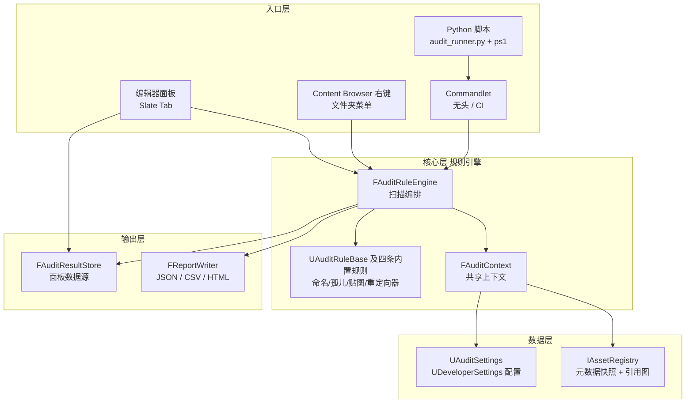

# 资产审计系统 · 开发主线

本文是 UEDevTest 当前工具（资产审计系统）的唯一执行文档，三部分：**一、架构设计（动手前必读）→ 二、目录结构设计（建工程时对照）→ 三、阶段任务清单（执行主线）**。项目定位、占位符约定（`<UE_ROOT>` / `<ProjectRoot>`）、环境事实见 [README](README.md)。

> 链接标记：✅ 已实测完全可访问；⚠ URL 有效但正文需浏览器 JS 渲染。若链接失效，在 [dev.epicgames.com 文档站](https://dev.epicgames.com/documentation/en-us/unreal-engine) 按标题搜索；**拿不准签名就查引擎源码 `<UE_ROOT>\Engine\Source\`——文档会过时，头文件不会**。
>
> 编译命令（每次改完代码就跑）：
> ```
> "<UE_ROOT>\Engine\Build\BatchFiles\Build.bat" UEDevTestEditor Win64 Development -project="<ProjectRoot>\UEDevTest.uproject" -WaitMutex
> ```

---

# 第一部分 · 架构设计（动手前必读）

## 1. 一句话定位

一个 UE 编辑器插件（AssetAudit）：用 Asset Registry 的元数据（**不加载资产**）扫描项目资产，按可配置规则产出结构化审计结果，支持编辑器内交互与无头 CI 两种运行方式。

## 2. 总体分层



设计要点：**入口可以有多个，权威核心只有一份**。Python 不重复实现规则，只作为无头入口和 CI 胶水；报告格式只在 ReportWriter 实现。

## 3. 核心抽象（五个类型，全部你自己写）

### 3.1 FAuditFinding —— 一条审计发现

报告、面板、JSON 共用的最小数据单元：

| 字段 | 类型 | 说明 |
|---|---|---|
| RuleId | FName | 命中的规则，如 `Rule.Naming` |
| Severity | 枚举 | Info / Warning / Error |
| AssetPathName | FString | 资产包路径，如 `/Game/Assets/T_MyTex`，面板双击可跳转 |
| Message | FString | 人可读的描述 |
| SuggestedFix | FString | 建议修复方式（可为空） |

它是 USTRUCT（反射可见），便于将来接蓝图或序列化。

### 3.2 FAuditContext —— 一次审计运行的共享上下文

普通 C++ struct（不需要反射）。一次 RunAudit 构建一次，所有规则共用：

- `IAssetRegistry*`：注册表接口指针
- `const UAuditSettings*`：用户配置
- `TArray<FAssetData> Assets`：过滤后的待审计资产列表
- `TMap<FName, TArray<FName>> ReferencersByPackage`：包 → 引用者列表，**一次构建，全规则共用**（孤儿规则靠它，避免每个规则各查一遍）

附带一个 `IsPackageExcluded(FAssetData)` 帮助函数：统一处理白名单路径和引擎内容排除，规则不用各写一遍。

### 3.3 UAuditRuleBase —— 规则基类

UCLASS，抽象语义（`UCLASS(Abstract)`），三个虚方法：

- `GetRuleId()`：规则唯一标识
- `GetDisplayName()`：UI 显示名
- `Check(const FAuditContext&, TArray<FAuditFinding>&)`：只读检查，向 OutFindings 追加结果

静态方法 `CollectRules()`：遍历 `TObjectIterator<UClass>` 找出所有非抽象子类，`NewObject` 到瞬态包并 `AddToRoot` 保活——**新规则不用注册表登记，继承即被发现**（反射自动发现，这是 UE 插件扩展的惯用法）。

> ⚠ **UE 约束**：UCLASS 会有 CDO（类默认对象）被真实构造，所以**不能用纯虚函数**（`= 0` 会编译失败）。引擎惯例：基类给"空实现/默认值"，子类 override。UHT 也只处理 .h 里的反射类型，规则类必须定义在头文件。

### 3.4 UAuditSettings —— 配置（UDeveloperSettings）

继承 `UDeveloperSettings`，`config=Engine, defaultconfig`，自动出现在 Project Settings → Game → Asset Audit。承载：扫描路径、各规则开关、命名前缀表（资产类名 → 前缀）、贴图最大尺寸/二次幂要求、白名单路径、报告输出目录与格式开关。

**规则行为全部来自配置，代码里不硬编码路径和命名模式**——这是"工业级"与"玩具"的分界线之一。

### 3.5 FAuditRuleEngine —— 编排器

静态类，一个入口 `RunAudit(ScanPathOverrides)`，负责六步（见下节）。不做任何具体检查——检查全部下放给规则。

## 4. 一次 RunAudit 的生命周期

1. **取配置**：`GetDefault<UAuditSettings>()`
2. **取注册表并等待就绪**：`FModuleManager::LoadModuleChecked<FAssetRegistryModule>("AssetRegistry")` → `WaitForCompletion()`
3. **构建上下文**：按配置的扫描路径构造 `FARFilter`（`bRecursivePaths=true`）→ `GetAssets()` → 过滤引擎内容 → 对每个唯一包调一次 `GetReferencers()` 构建引用图
4. **规则调度**：`UAuditRuleBase::CollectRules()` → 逐个 `Check(Context, Findings)`
5. **排序**：按 Severity 降序 + RuleId，保证报告稳定可 diff
6. **输出**：结果进 `FAuditResultStore`（面板数据源），并按配置写 JSON/CSV/HTML

## 5. 性能设计原则（对应自研引擎的教训）

- **只碰元数据，不 LoadObject**：贴图尺寸、压缩设置全走 `FAssetData::GetTagValue`；扫描一万资产和加载一万资产是两个数量级的差距
- **引用图一次构建**：`GetReferencers` 每包只调一次，放 Context 里复用；孤儿判定 = "引用者集合为空"，O(资产数)
- **注册表自等待**：Commandlet 冷启动时注册表是异步加载的，必须 `WaitForCompletion()`，否则拿到空列表还不报错
- **规则无状态**：Check 是 const 的，将来要并行化（ParallelFor）不用改架构

## 6. 与自研引擎审计工具的映射

| 自研引擎概念 | UE 对应物 | 差异点 |
|---|---|---|
| 引用数据库 | IAssetRegistry | UE 是异步收集 + 全局缓存；要先 WaitForCompletion |
| 资产描述符 | FAssetData | 5.8 字段名：PackageName（全路径）/ PackagePath（目录）/ AssetName / AssetClassPath |
| 规则接口 | UAuditRuleBase | UE 无纯虚，反射自动发现替代手动注册 |
| 规则配置文件 | UDeveloperSettings | 进编辑器设置 UI，可 config 热改 |
| 无头批处理 | UCommandlet | 退出码即 CI 信号 |
| 编辑器面板 | Slate + TabManager | 比 PySide 多一层反射/宏 |
| 右键菜单 | UToolMenus 扩展 | 菜单按名字符串挂载，Context 对象带选中项 |
| 报告生成 | FReportWriter | JSON 库字段名参数是 FStringView |

这张表就是面试时"经验平移"的素材来源。

## 7. 扩展路径（做完 V1 后的自然延伸）

- **新规则**：继承 UAuditRuleBase 写一个新类即可，引擎自动发现——演示这个机制本身就是作品集亮点
- **新报告格式**：只动 FReportWriter
- **规则以蓝图/资产扩展**：把 NamingPrefixes 换成 DataAsset——V2 再考虑
- **CI 接入**：Commandlet 退出码 + GitHub Actions 调 ps1（阶段 7、8）

---

# 第二部分 · 目录结构设计

## 全目录树

```
<ProjectRoot>/
├── UEDevTest.uproject                    # 工程描述：引擎版本、模块表、启用的插件
├── Config/
│   ├── DefaultEngine.ini                 # 引擎配置（默认地图等；UAuditSettings 的默认值也会写进这里）
│   └── DefaultEditor.ini                 # 编辑器/Python 插件配置
├── Content/
│   ├── Python/
│   │   └── audit_runner.py               # [阶段7] Python 入口：调 Commandlet、读报告、打印摘要
│   └── DemoAssets/                       # [阶段8] 演示夹具：坏命名/超规格贴图/孤儿/重定向器
├── Plugins/
│   └── AssetAudit/                       # ★ 全部工作量的所在：Editor-only 插件
│       ├── AssetAudit.uplugin            #   插件描述：一个 Editor 模块 AssetAuditEditor
│       └── Source/
│           └── AssetAuditEditor/
│               ├── AssetAuditEditor.Build.cs          # 模块依赖声明
│               ├── Public/                            # 对外暴露（将来其他模块/插件可依赖）
│               │   ├── AssetAuditEditorModule.h       #   模块类：Startup/Shutdown、菜单注册
│               │   ├── AuditTypes.h                   #   EAuditSeverity、FAuditFinding、FAuditContext
│               │   ├── AuditSettings.h                #   UAuditSettings（UDeveloperSettings）
│               │   └── AuditRuleBase.h                #   UAuditRuleBase（规则基类）
│               └── Private/
│                   ├── AuditRuleEngine.h/.cpp         #   编排：过滤→引用图→规则调度→排序
│                   ├── AuditResultStore.h/.cpp        #   最近一次结果的全局存储（面板数据源）
│                   ├── ReportWriter.h/.cpp            #   JSON/CSV/HTML 三格式导出
│                   ├── AssetAuditCommandlet.h/.cpp    #   无头入口，退出码=CI 信号
│                   ├── AuditPanelWidget.h/.cpp        #   Slate 面板 + 行控件
│                   ├── AssetAuditEditorModule.cpp     #   模块实现：TabSpawner、ToolMenus 扩展
│                   └── Rules/
│                       ├── Rule_Naming.h/.cpp         #   规则1：命名前缀
│                       ├── Rule_OrphanAssets.h/.cpp   #   规则2：孤儿资产
│                       ├── Rule_TextureSpec.h/.cpp    #   规则3：贴图规格（尺寸/二次幂/压缩）
│                       └── Rule_Redirectors.h/.cpp    #   规则4：重定向器残留
├── Source/
│   ├── UEDevTest.Target.cs               # Game 目标（打包用；最小写法）
│   ├── UEDevTestEditor.Target.cs         # Editor 目标（开发用）
│   └── UEDevTest/
│       ├── UEDevTest.Build.cs            # 工程默认模块依赖
│       ├── Public/UEDevTest.h            # 最小壳（一行 include）
│       └── Private/UEDevTest.cpp         # IMPLEMENT_PRIMARY_GAME_MODULE
├── scripts/
│   └── run_audit.ps1                     # [阶段7] 无头审计包装脚本（纯 ASCII）
├── docs/                                 # 本文档集（随仓库走，作品集的一部分）
├── .gitignore                            # 见下节
└── Saved/Intermediate/Binaries/...       # 自动生成，永不入库
```

## 文件命名与放置约定

- **Public / Private 的分界**：别的模块将来可能 include 的（类型、规则基类）放 Public；模块内部实现（引擎、报告、面板、规则实例）放 Private。判断标准："这个头文件被 include 后，外部能否正确使用？"
- **反射类型必须放 .h**（见阶段 2 的坑）；每份 .h 的最后一个 include 是它自己的 `X.generated.h`
- **一个规则一对文件**（Rule_X.h + Rule_X.cpp），互不引用，删掉一对不影响其他规则
- 引擎头文件路径习惯：`AssetRegistry/AssetData.h` 这种斜杠写法对应引擎 Public 树的结构，照抄引擎源码里的写法

## .gitignore（作品集仓库用）

```gitignore
# UE 构建产物
Binaries/
Intermediate/
DerivedDataCache/
Saved/
Plugins/**/Binaries/
Plugins/**/Intermediate/

# IDE
.vs/
.vscode/
*.sln
*.suo
*.VC.db
*.VC.opendb

# OS
Thumbs.db
.DS_Store
```

## 先建哪些、后建哪些

- **阶段 0 只建**：uproject、Source（Target.cs ×2 + 模块三件套）、Config 两个 ini——保证第一次编译通过
- **阶段 1 加**：Plugins/AssetAudit 整棵树（先是空模块，编译通过再往里加文件）
- **每加一个 .h/.cpp 就编译一次**：UE 编译错误会连锁放大（如一个字段名写错会伪装成 Printf"参数不足"），小步提交定位成本最低
- `Content/Python`、`scripts`、`DemoAssets` 分别在阶段 7、8 才需要，不必提前建

---

# 第三部分 · 阶段任务清单（执行主线）

按顺序做。每阶段四件套：**做什么 → 接口要点（API 签名 + ⚠坑 + 官方文档）→ 完成标准**。完成标准是硬性的，全部满足才算过。

## 阶段 0 · 新建 C++ 工程

**做什么**：Epic Launcher 里 UE 5.8 → Games → Blank → C++，工程名 `UEDevTest`，位置自定（下文记作 `<ProjectRoot>`）。建完先启动一次编辑器确认能开。（启动器打不开时，直接运行 `<UE_ROOT>\Engine\Binaries\Win64\UnrealEditor.exe`，在工程浏览器里新建，效果一样。）

**涉及**：.uproject 结构、Source 三件套、Target.cs（对照第二部分目录树）。

**完成标准**：
- [ ] `<ProjectRoot>\UEDevTest.uproject` 存在，双击能打开编辑器
- [ ] `Source/` 下有两个 Target.cs 和一个模块目录
- [ ] .gitignore 就位，`git init` + 首次 commit

## 阶段 1 · AssetAudit 插件壳

**做什么**：手建 `Plugins/AssetAudit` 整棵树：uplugin + AssetAuditEditor 模块（Build.cs + 模块 .h/.cpp，StartupModule 留空）。uproject 里启用它。第一次编译插件。

**接口要点**：

- `.uproject`：`EngineAssociation: "5.8"`；`Modules` 声明工程默认模块；`Plugins` 里启用 `PythonScriptPlugin`、`EditorScriptingUtilities` 和自定义的 `AssetAudit`（`TargetAllowList: ["Editor"]`）
- `.uplugin`：模块 `Type: "Editor"`、`LoadingPhase: "Default"`
- `AssetAuditEditor.Build.cs` 依赖：
  - Public：`Core, CoreUObject, Engine, AssetRegistry, DeveloperSettings`
  - Private：`UnrealEd, Projects, Slate, SlateCore, ToolMenus, ContentBrowser, ContentBrowserData, Json, JsonUtilities, EditorScriptingUtilities, PythonScriptPlugin`
- ⚠ **坑：Target.cs 必须用 `BuildSettingsVersion.Latest` + `IncludeOrderVersion.Latest`**——用旧的 V5 会报"modifies the values of properties ... not allowed"（安装版引擎共享构建环境的要求）
- ⚠ **坑：generated.h 必须是所在头文件的最后一个 include**

**官方文档**：✅ [Plugins in Unreal Engine](https://dev.epicgames.com/documentation/en-us/unreal-engine/plugins-in-unreal-engine)（插件结构、.uplugin 详解）；⚠ [游戏性架构总览](https://dev.epicgames.com/documentation/en-us/unreal-engine/unreal-engine-architecture-overview)；最好的教材是 `Engine\Plugins\Editor\` 下任意自带插件。

**完成标准**：
- [ ] 编译输出 `Result: Succeeded`
- [ ] `Binaries/Win64/UnrealEditor-AssetAuditEditor.dll` 生成
- [ ] 打开编辑器 → Edit → Plugins 里能搜到 Asset Audit 且已启用

## 阶段 2 · 审计核心（类型 + 引擎）

**做什么**：写 4 个核心类型文件——AuditTypes.h（枚举 + Finding + Context）、AuditSettings.h（DeveloperSettings，含全部配置项和默认值）、AuditRuleBase.h/.cpp（基类 + CollectRules 反射发现）、AuditRuleEngine.h/.cpp（六步编排）。此时可先写一条临时规则验证链路，也可直接进阶段 3。

**接口要点 · Asset Registry（核心数据源）**：

- 取接口：`FModuleManager::LoadModuleChecked<FAssetRegistryModule>("AssetRegistry")` → `.Get()`；头文件 `AssetRegistry/AssetRegistryModule.h` 与 `AssetRegistry/IAssetRegistry.h`
- `void WaitForCompletion()`：等待异步扫描完成，Commandlet/冷启动必调，否则拿到空列表还不报错
- `bool GetAssets(const FARFilter& Filter, TArray<FAssetData>& Out)`：FARFilter 设 `bRecursivePaths=true` + `PackagePaths`（FName 数组）
- `bool GetReferencers(FName PackageName, TArray<FName>& Out, EDependencyCategory = All)`：查"谁引用了这个包"——引用图就靠它，每包只查一次放 Context 复用
- `FAssetData`（注意在 CoreUObject 模块，头文件 `AssetRegistry/AssetData.h`）：
  - 字段：`PackageName`（`/Game/Folder/Asset`）、`PackagePath`（`/Game/Folder`）、`AssetName`、`AssetClassPath`（FTopLevelAssetPath）
  - ⚠ **坑：没有 `PackagePathName` 这个字段**（编译 C2039 的连锁错误会伪装成 Printf"参数不足"）
  - 类短名：`AssetClassPath.GetAssetName()`（如 `Texture2D`）；判断重定向器即与 `FName("ObjectRedirector")` 比较
  - `template<typename T> bool GetTagValue(FName Tag, T& Out)`：读元数据标签（SizeX/SizeY/CompressionSettings...），**不加载资产**
- ⚠ **坑：UHT 只处理头文件**——所有带 UCLASS/USTRUCT/UENUM 的类型必须放 .h，.cpp 只放实现（写 .cpp 里会报"无法打开 generated.h"）
- ⚠ **坑：UCLASS 禁止纯虚函数（`= 0`）**——UCLASS 有 CDO 会被真实构造，纯虚直接 C2259。抽象基类用"虚函数 + 默认空实现"，子类 override
- ⚠ **坑：反射自动发现要过滤**——`TObjectIterator<UClass>` 里跳过 `Class == StaticClass()`、非子类、`HasAnyClassFlags(CLASS_Abstract)` 的类；发现的实例 `NewObject` 到瞬态包后 `AddToRoot()`，用完 `RemoveFromRoot()`

**接口要点 · UDeveloperSettings（配置系统）**：

- 类声明：`UCLASS(config=Engine, defaultconfig)`，属性 `UPROPERTY(EditAnywhere, config, Category="...")`；数组配路径用 `FDirectoryPath`
- 三个虚函数决定设置页位置：`GetContainerName()` 返回 `TEXT("Project")`、`GetCategoryName()` 返回 `TEXT("Game")`、`GetSectionName()`
- 取值：`GetDefault<UAuditSettings>()`；持久化到 `Config/DefaultEngine.ini` 的 `[/Script/AssetAuditEditor.AuditSettings]` 节

**官方文档**：✅ [Asset Registry in Unreal Engine](https://dev.epicgames.com/documentation/en-us/unreal-engine/asset-registry-in-unreal-engine)（FAssetData、FARFilter、Tags and Values 全覆盖）；⚠ [Editor Preferences and Project Settings](https://dev.epicgames.com/documentation/en-us/unreal-engine/editor-preferences-and-project-settings-in-unreal-engine)；[API 参考](https://dev.epicgames.com/documentation/en-us/unreal-engine/API/) 按 `UDeveloperSettings` 搜；更直接的学习材料是在引擎源码搜 `config=Engine, defaultconfig`。

**完成标准**：
- [ ] 编译通过；编辑器 Edit → Project Settings → Game 下出现 Asset Audit 页，能改配置并保存（重启后保留，检查 DefaultEngine.ini 出现配置节）
- [ ] 临时验证：任意方式（日志输出）确认 CollectRules 能发现规则、RunAudit 能拿到资产数量并打日志

## 阶段 3 · 四条内置规则

**做什么**：Rules/ 下四对文件（.h 定义 UCLASS、.cpp 放实现），逐条实现、逐条验证：
1. Naming：类名查前缀表 → 前缀不匹配报 Warning，SuggestedFix 给出建议名
2. OrphanAssets：引用者集合为空且非重定向器 → Info
3. TextureSpec：GetTagValue 读 SizeX/SizeY → 非二次幂 Warning、超上限 Error、压缩设置 Default → Info
4. Redirectors：ObjectRedirector → Warning

**接口要点**：全部用阶段 2 已核实的 API，无新接口。规则保持无状态（Check 是 const），为将来并行化留路。

**完成标准**：
- [ ] 四条规则都编译通过，且 RunAudit 的输出顺序是 Severity 降序
- [ ] 故意命名的违规资产被命中，正常资产不误报

## 阶段 4 · 报告导出

**做什么**：ReportWriter：JSON（FJsonObject/FJsonSerializer）、CSV（拼接+转义+SaveStringToFile）、HTML（含样式和转义）；输出到 ProjectDir 下配置目录，文件名带时间戳；只导出配置开启的格式。

**接口要点**：

- JSON：`FJsonObject` + `FJsonSerializer::Serialize(Root, TJsonWriterFactory<>::Create(&OutString))`；include `Dom/JsonObject.h`、`Serialization/JsonSerializer.h`、`Serialization/JsonWriter.h`
  - ⚠ **坑：5.8 的 `SetArrayField / SetStringField / SetNumberField` 第一参数是 `FStringView`**，直接传 `TEXT("X")` 会报 C2665
- CSV/HTML：字符串拼接 + `FFileHelper::SaveStringToFile(Content, *FilePath, FFileHelper::EEncodingOptions::ForceUTF8WithoutBOM)`
- 目录创建：`FPlatformFileManager::Get().GetPlatformFile().CreateDirectoryTree(*Dir)`
- 时间戳：`FDateTime::Now().ToString(TEXT("%Y%m%d_%H%M%S"))`
- 输出路径：`FPaths::Combine(FPaths::ProjectDir(), 配置的相对目录)`
- CSV 字段含逗号/引号要转义（引号加倍 + 整体加引号）；HTML 要转义 `& < > "`

**官方文档**：⚠ [JSON Utilities in Unreal Engine](https://dev.epicgames.com/documentation/en-us/unreal-engine/json-utilities-in-unreal-engine)；CSV/HTML 无官方页，纯 C++ 字符串处理。

**完成标准**：
- [ ] 三种报告都生成且内容正确：JSON 可被解析、CSV 列数一致、HTML 浏览器打开可读
- [ ] 报告含统计摘要（Total/Errors/Warnings/Infos）和引擎版本
- [ ] CSV 里含逗号的消息字段不被撑破列

## 阶段 5 · Commandlet（无头 CI）

**做什么**：AssetAuditCommandlet：Main 里跑审计、写报告、按 Error 数返回退出码；命令行实测。

**接口要点**：

- `UCLASS()` 继承 `UCommandlet`（Engine 模块，头文件 `Commandlets/Commandlet.h`），override `virtual int32 Main(const FString& Params)`
- 构造函数里设：`IsClient=false; IsServer=false; IsEditor=true; LogToConsole=true;`
- 调用方式：`<UE_ROOT>\Engine\Binaries\Win64\UnrealEditor-Cmd.exe <项目>.uproject -run=AssetAudit -stdout -unattended -nosplash`（`-run=X` 对应类名 `UXCommandlet`）
- **退出码约定**：Main 返回非 0 = 有 Error 级命中——这是 CI 能用的硬指标，必须实现

**官方文档**：⚠ [Commandlets in Unreal Engine](https://dev.epicgames.com/documentation/en-us/unreal-engine/commandlets-in-unreal-engine)。

**完成标准**：
- [ ] 无头命令跑通并生成报告
- [ ] 无 Error 命中时退出码 0；把某条规则临时调到产生 Error 后，退出码为 1（`$LASTEXITCODE` 验证）
- [ ] 冷启动直接跑（不先开编辑器）也能拿到完整资产列表（验证 WaitForCompletion）

## 阶段 6 · 面板与右键入口（编辑器交互）

**做什么**：
1. Slate 审计面板：Run Audit / Export 按钮、计数文本、五列表格、双击打开资产、通知气泡
2. FAuditResultStore：规则引擎结果 → 面板刷新的桥
3. 模块里注册 Nomad TabSpawner + ToolMenus 两处入口（Window 菜单、Content Browser 文件夹右键）

**接口要点 · ToolMenus（菜单与右键扩展）**：

- 时机：`StartupModule` 里 `UToolMenus::RegisterStartupCallback(回调)`，回调里再扩展菜单（过早扩展会被引擎重建覆盖）；Shutdown 时 `UnRegisterStartupCallback` + `UnregisterOwner`
- 扩展已有菜单：`UToolMenus::Get()->ExtendMenu(菜单名)` → `FindOrAddSection(节名)` → `Section.AddMenuEntry(FName, FText, FText, FSlateIcon, FUIAction)`
- 本系统用到的菜单名（字符串挂载）：`LevelEditor.MainMenu.Window`（节 `WindowLayout`）——Window 菜单；`ContentBrowser.FolderContextMenu`——文件夹右键
- 拿文件夹选中路径：菜单项用 `Section.AddDynamicEntry(FName, FNewToolMenuSectionDelegate)`，委托参数 `FToolMenuSection&` 里 `FindContext<UContentBrowserFolderContext>()` → `SelectedPackagePaths`（`TArray<FString>`，头文件 `Editor\ContentBrowser\Public\ContentBrowserMenuContexts.h`，ContentBrowser 模块）
- 上下文数据要在 lambda 里**按值捕获**再执行（点击回调时上下文未必还活着）

**接口要点 · Slate 面板与 TabManager**：

- 面板：`SCompoundWidget` 子类 + `SLATE_BEGIN_ARGS/SLATE_END_ARGS`；`SButton`（`OnClicked` 返回 `FReply::Handled()`）；`STextBlock` 用 `.Text(this, &SPanel::Getter)` 惰性刷新
- 列表：`SListView<TSharedPtr<行数据>>` + `SHeaderRow` 列定义；行是 `SMultiColumnTableRow<T>` 子类，override `GenerateWidgetForColumn(FName)` 按列名返回内容
  - ⚠ **坑：`class SListView;` 不能普通前向声明**（类模板，报 C2990），直接 include `Widgets/Views/SListView.h`
- 注册标签页：`FGlobalTabmanager::Get()->RegisterNomadTabSpawner(TabId, FOnSpawnTab::...).SetDisplayName(...).SetMenuType(ETabSpawnerMenuType::Enabled)`；Spawn 回调返回 `SNew(SDockTab).TabRole(ETabRole::NomadTab)[ SNew(面板) ]`；打开：`TryInvokeTab(TabId)`
- 双击行打开资产：`GEditor->GetEditorSubsystem<UAssetEditorSubsystem>()->OpenEditorForAsset(路径)`（include `Editor.h`、`Subsystems/AssetEditorSubsystem.h`）
- 通知气泡：`FSlateNotificationManager::Get().AddNotification(FNotificationInfo)`

**官方文档**：⚠ [Tool Menus in Unreal Engine](https://dev.epicgames.com/documentation/en-us/unreal-engine/tool-menus-in-unreal-engine)；⚠ [Slate UI Framework](https://dev.epicgames.com/documentation/en-us/unreal-engine/slate-ui-framework-in-unreal-engine)；[API 参考](https://dev.epicgames.com/documentation/en-us/unreal-engine/API/) 按 `SListView`、`FGlobalTabmanager` 搜；更实用的是引擎源码 `Engine\Source\Editor\` 下搜 `RegisterNomadTabSpawner`。

**完成标准**：
- [ ] Window 菜单点开面板；Content Browser 右键文件夹 → Run Asset Audit Here → 面板自动打开并显示该文件夹的审计结果
- [ ] 双击一行能在编辑器里打开对应资产
- [ ] Export Reports 出通知气泡，报告文件落盘

## 阶段 7 · Python 层与 CI 脚本

**做什么**：
1. `scripts/run_audit.ps1`：调 Commandlet（参数化 uproject 路径），结束后按退出码输出 PASS/FAIL——纯 ASCII
2. `Content/Python/audit_runner.py`：读最新 JSON 报告，打印按规则分组的摘要（Python 只做胶水，不重复实现规则）

**接口要点**：

- 启用：`.uproject` 的 Plugins 里启用 `PythonScriptPlugin`
- 无头跑 Python：`UnrealEditor-Cmd.exe <项目>.uproject -run=pythonscript -script="路径.py"`
- 编辑器内：Output Log 切 Python 控制台；`Content/Python/` 目录自动加入 sys.path
- `unreal` 模块能调大部分编辑器 API；Python 的价值是胶水：调 Commandlet、检查报告产物、打印摘要（体现 Python + C++ 双轨）
- 注意：编辑器 Python 与系统 Python 是两回事；系统侧跑 ps1 时才涉及 `PYTHONUTF8=1`；ps1 避开 `%` 字符

**官方文档**：⚠ [Scripting and Automating the Editor](https://dev.epicgames.com/documentation/en-us/unreal-engine/scripting-and-automating-the-editor)（其下有 Python 入门/内置脚本/远端执行等子页）。

**完成标准**：
- [ ] PowerShell 里跑 ps1：退出码 0/1 与 Commandlet 一致，中文输出不乱码
- [ ] `-run=pythonscript -script=...` 跑通，摘要打印与 JSON 内容一致

## 阶段 8 · 演示夹具与作品集打磨

**做什么**：
1. 制造四类违规资产做演示夹具（也是规则自测用例）：
   - 坏命名：`Content/DemoAssets/` 下建不带前缀的 Texture2D / Material / StaticMesh（先在配置里设好前缀）
   - 超规格贴图：导入大于上限或非二次幂的图
   - 孤儿资产：建一个不被任何东西引用的资产
   - 重定向器：把资产移动到另一个文件夹（默认留重定向器）
2. docs/ 补两页面向读者的文档：`AssetAudit_README.md`（项目门面：是什么/亮点/截图/运行方式）和 `规则说明.md`（每条规则的判定逻辑与配置项）
3. 截图：面板带命中结果、HTML 报告、Project Settings 配置页
4. git 历史整理 + 远程仓库

**完成标准**：
- [ ] 四类夹具全部命中，无 Error 级误报；HTML 报告可直接作为作品集配图
- [ ] 面向陌生人做个 3 分钟自述：这个系统是什么、架构怎么分层、哪一步体现 UE 特有设计——说不出来说明还有欠账
